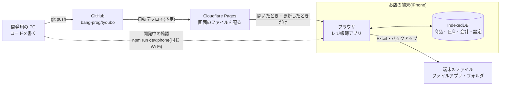
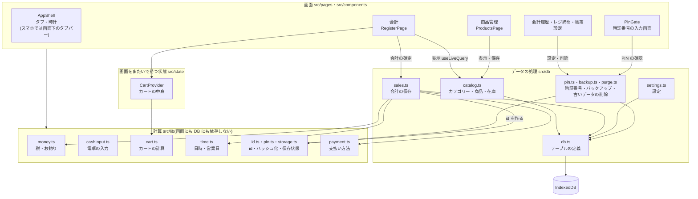
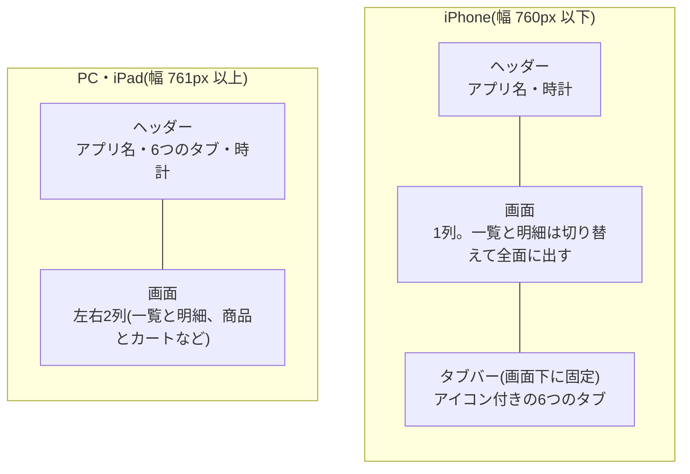
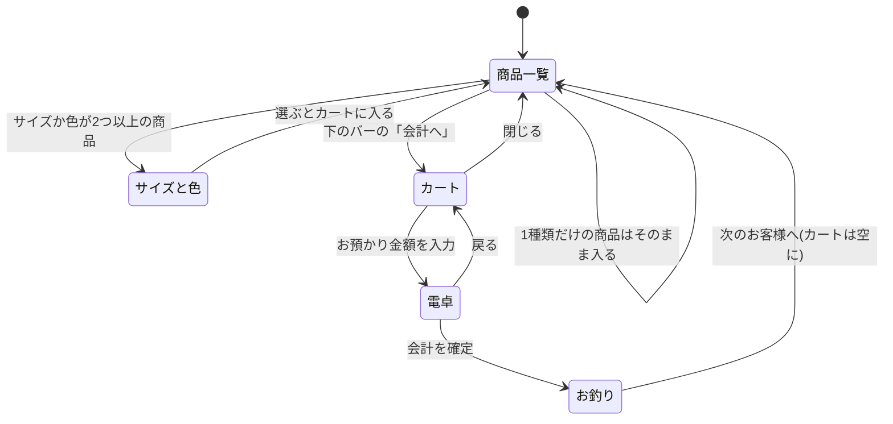
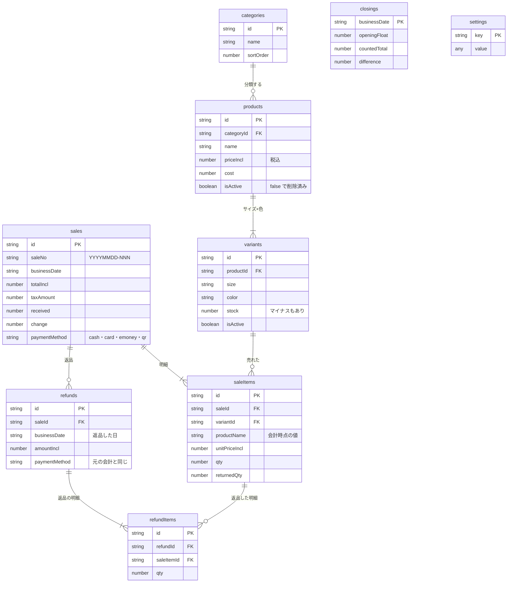
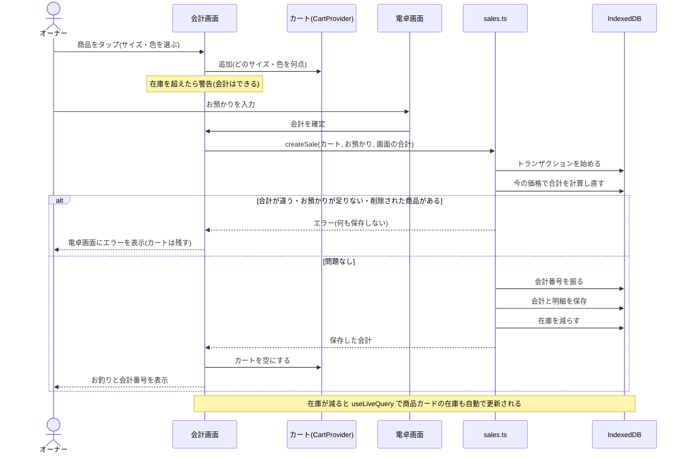

# レジ帳簿 アーキテクチャ

- 更新:2026-11-08(ステップ⑬まで実装済み)
- 仕様:[spec.md](spec.md)

図は Mermaid で書いています。GitHub ではそのまま図として表示されます。

---

## 1. 全体の構成

サーバーは画面のファイルを配るだけです。**データはお店の端末のブラウザの中(IndexedDB)にだけ保存し、外には送りません。**

| 部分 | 使っているもの | 状態 |
|---|---|---|
| 画面 | React + TypeScript(Vite でビルド) | 実装中 |
| データの保存 | IndexedDB(Dexie.js で操作) | 実装中 |
| 画面のファイルの配信 | Cloudflare Pages | 予定 |
| Excel の出力 | ExcelJS | 実装中 |

---

## 2. コードの層

上の層は下の層を使いますが、下の層は上の層を知りません。計算(`src/lib`)は画面にもデータベースにも依存しないので、テストだけで正しさを確かめられます。

| フォルダ | 役割 | 主なファイル |
|---|---|---|
| `src/pages` | タブごとの画面 | `RegisterPage`、`ProductsPage`、`HistoryPage`、`ClosingPage`、`LedgerPage`、`SettingsPage` |
| `src/components` | 画面の部品 | `AppShell`、`Modal`、`PayDialog`(電卓)、`ChangeDialog`(完了)、`register/*`、`products/*`、`pin/*`(暗証番号)、`settings/*` |
| `src/state` | タブを切り替えても残す状態 | `CartProvider`(カート) |
| `src/db` | データの保存・読み込み。入力のチェックとトランザクションもここ | `db.ts`、`catalog.ts`、`sales.ts`、`settings.ts`、`pin.ts`、`backup.ts`、`purge.ts`、`errors.ts` |
| `src/lib` | 計算だけの関数 | `money.ts`、`cashInput.ts`、`cart.ts`、`time.ts`、`labels.ts`、`payment.ts`(支払い方法)、`id.ts`(id を作る)、`pin.ts`(ハッシュ化)、`storage.ts`(保存状態) |
| `src/styles` | 色・文字・共通の部品の見た目 | `global.css` |

**決まりごと**
- 画面から IndexedDB を直接さわらない。必ず `src/db` の関数を通す。
- 入力のチェックは `src/db` の関数の中で行う。どの画面から保存しても同じ決まりが守られる。
- 画面の表示は `useLiveQuery` で読む。保存するとデータベースが変わり、画面は自動で描き直される。
- 金額はすべて円単位の整数で扱う。

---

## 3. 画面の配置(スマホと PC)

使う端末は iPhone なので、**スマホの縦向き(幅 360〜430px)を基準**にしています(仕様書 §10.1)。画面の幅が **760px 以下**ならスマホの配置、それより広ければ PC・iPad の配置にします。切り替えは CSS(`@media (max-width: 760px)`)だけで行い、画面の部品は同じものを使います。

| 画面 | iPhone での配置 |
|---|---|
| 全体 | タブは画面下に固定し、親指で押せるようにする。ノッチとホームバーにはセーフエリアの余白をとる |
| 会計 | 商品の一覧を全面に出し、下に「合計 / 点数 / 会計へ」のバーを固定。「会計へ」でカートが下から開く |
| 電卓 | 縦1列。キーの高さを画面の高さ(dvh)に合わせ、スクロールせずに収める |
| サイズ・色 | 色ごとに、サイズのボタンを折り返して並べる |
| 商品管理・会計履歴 | 一覧から選ぶと入力欄・明細を全面に開き、「一覧に戻る」で戻る。表は列を減らす |
| 帳簿 | 表は横スクロール。日付の列は左に残す。集計の数字は小さくまとめる |
| 入力欄 | 文字は 16px 以上(iPhone の Safari がタップしたときに画面を拡大しないように) |

スマホの会計は次の順に進みます。

**開発中に iPhone で確かめるとき**:PC で `npm run dev:phone` を実行し、同じ Wi-Fi の iPhone から表示された `http://PC の IP アドレス:5173` を開きます。http で開くと暗証番号は使えません(https か localhost でしか使えない機能のため)。データの id は http でも作れるようにしてあります(`src/lib/id.ts`)。

---

## 4. データの構造

- 商品やサイズ・色は消さずに `isActive: false` にする(論理削除)。過去の売上が参照しているため。
- 会計の明細には、商品名・カテゴリー名・価格を会計した時点の値で書き写す。あとで商品を編集しても、過去の帳簿が変わらない。
- 返品(`refunds`、`refundItems`)はステップ⑨、レジ締め(`closings`)はステップ⑩から使っている。

---

## 5. 会計の流れ(ステップ⑦)

---

## 6. 実装の状況

| # | 機能 | 主なファイル | 状態 |
|---|---|---|---|
| 1 | プロジェクトの準備 | `package.json`、`vite.config.ts`、`eslint.config.js` | ✅ |
| 2 | 金額計算 | `src/lib/money.ts` | ✅ |
| 3 | 画面の枠 | `src/components/AppShell.tsx` | ✅ |
| 4 | 電卓画面 | `src/components/PayDialog.tsx`、`src/lib/cashInput.ts` | ✅ |
| 5 | データの土台 | `src/db/db.ts`、`src/db/types.ts`、`src/db/settings.ts` | ✅ |
| 6 | 商品管理 | `src/db/catalog.ts`、`src/components/products/*` | ✅ |
| 7 | 会計 | `src/db/sales.ts`、`src/lib/cart.ts`、`src/components/register/*` | ✅ |
| 8 | 会計履歴 | `src/db/history.ts`、`src/components/history/*` | ✅ |
| 9 | 返品 | `src/db/refunds.ts`、`SaleDetailPanel.tsx` | ✅ |
| 10 | レジ締め | `src/db/closings.ts`、`src/lib/closing.ts`、`src/components/closing/*` | ✅ |
| 11 | 帳簿と Excel 出力 | `src/db/ledger.ts`、`src/lib/ledgerExcel.ts`、`src/components/ledger/*` | ✅ |
| 12 | 設定(暗証番号、バックアップ、古いデータの削除) | `src/db/pin.ts`、`src/db/backup.ts`、`src/db/purge.ts`、`src/components/pin/*`、`src/components/settings/*`、`PurgeDialog.tsx` | ✅ |
| 13 | スマホ対応(仕様書 §10.1) | `AppShell`、各画面の `*.module.css`(幅 760px 以下の指定)、`src/lib/id.ts` | ✅ |
| 14 | PWA と実機での確認 | | ⬜ |
