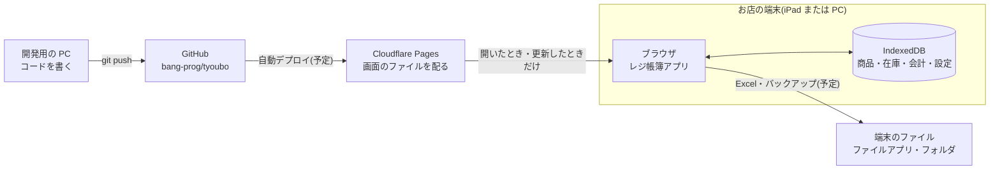
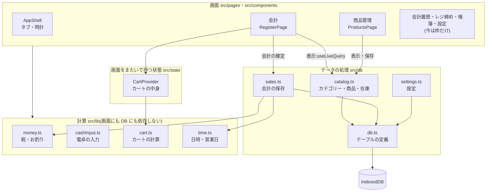
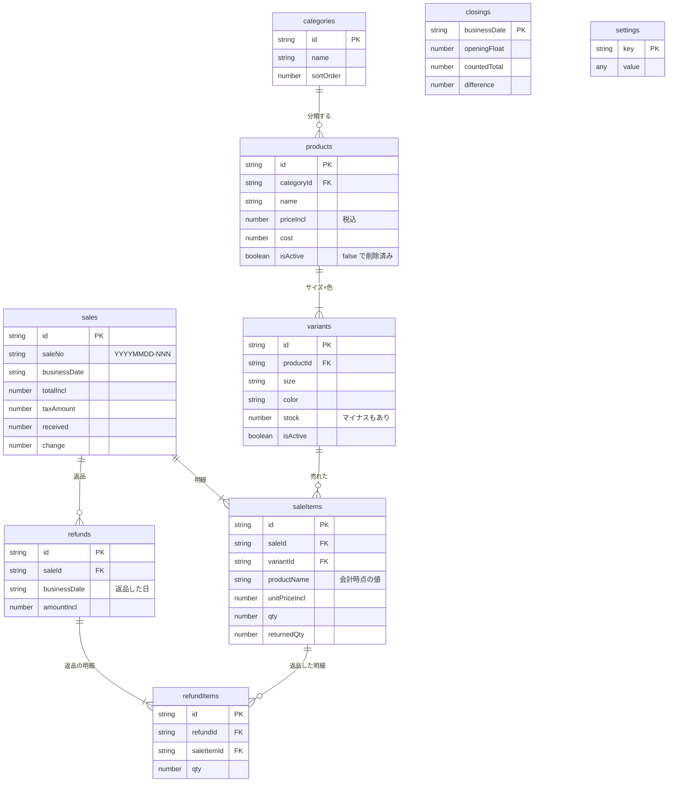
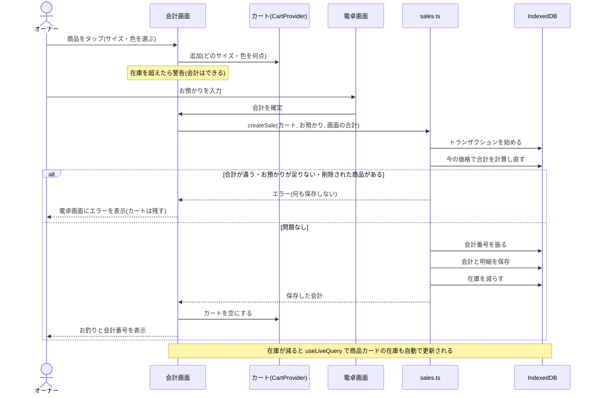

# レジ帳簿 アーキテクチャ

- 更新:2026-11-04(ステップ⑦まで実装済み)
- 仕様:[spec.md](spec.md)

図は Mermaid で書いています。GitHub ではそのまま図として表示されます。

---

## 1. 全体の構成

サーバーは画面のファイルを配るだけです。**データはお店の端末のブラウザの中(IndexedDB)にだけ保存し、外には送りません。**

| 部分 | 使っているもの | 状態 |
|---|---|---|
| 画面 | React + TypeScript(Vite でビルド) | 実装中 |
| データの保存 | IndexedDB(Dexie.js で操作) | 実装中 |
| 画面のファイルの配信 | Cloudflare Pages | 予定 |
| Excel の出力 | ExcelJS | 予定 |

---

## 2. コードの層

上の層は下の層を使いますが、下の層は上の層を知りません。計算(`src/lib`)は画面にもデータベースにも依存しないので、テストだけで正しさを確かめられます。

| フォルダ | 役割 | 主なファイル |
|---|---|---|
| `src/pages` | タブごとの画面 | `RegisterPage`、`ProductsPage` |
| `src/components` | 画面の部品 | `AppShell`、`Modal`、`PayDialog`(電卓)、`ChangeDialog`(完了)、`register/*`、`products/*` |
| `src/state` | タブを切り替えても残す状態 | `CartProvider`(カート) |
| `src/db` | データの保存・読み込み。入力のチェックとトランザクションもここ | `db.ts`、`catalog.ts`、`sales.ts`、`settings.ts`、`errors.ts` |
| `src/lib` | 計算だけの関数 | `money.ts`、`cashInput.ts`、`cart.ts`、`time.ts`、`labels.ts` |
| `src/styles` | 色・文字・共通の部品の見た目 | `global.css` |

**決まりごと**
- 画面から IndexedDB を直接さわらない。必ず `src/db` の関数を通す。
- 入力のチェックは `src/db` の関数の中で行う。どの画面から保存しても同じ決まりが守られる。
- 画面の表示は `useLiveQuery` で読む。保存するとデータベースが変わり、画面は自動で描き直される。
- 金額はすべて円単位の整数で扱う。

---

## 3. データの構造

- 商品やサイズ・色は消さずに `isActive: false` にする(論理削除)。過去の売上が参照しているため。
- 会計の明細には、商品名・カテゴリー名・価格を会計した時点の値で書き写す。あとで商品を編集しても、過去の帳簿が変わらない。
- `refunds`、`refundItems`、`closings` はテーブルだけ用意してあり、使うのはステップ⑨・⑩から。

---

## 4. 会計の流れ(ステップ⑦)

---

## 5. 実装の状況

| # | 機能 | 主なファイル | 状態 |
|---|---|---|---|
| 1 | プロジェクトの準備 | `package.json`、`vite.config.ts`、`eslint.config.js` | ✅ |
| 2 | 金額計算 | `src/lib/money.ts` | ✅ |
| 3 | 画面の枠 | `src/components/AppShell.tsx` | ✅ |
| 4 | 電卓画面 | `src/components/PayDialog.tsx`、`src/lib/cashInput.ts` | ✅ |
| 5 | データの土台 | `src/db/db.ts`、`src/db/types.ts`、`src/db/settings.ts` | ✅ |
| 6 | 商品管理 | `src/db/catalog.ts`、`src/components/products/*` | ✅ |
| 7 | 会計 | `src/db/sales.ts`、`src/lib/cart.ts`、`src/components/register/*` | ✅ |
| 8 | 会計履歴 | | ⬜ |
| 9 | 返品 | | ⬜ |
| 10 | レジ締め | | ⬜ |
| 11 | 帳簿と Excel 出力 | | ⬜ |
| 12 | 設定(暗証番号、バックアップ、古いデータの削除) | | ⬜ |
| 13 | PWA と実機での確認 | | ⬜ |
